# Mini app examples

A mini app is a small tool that runs on top of your DocAI data. You describe what you want to Claude (or another AI assistant connected over MCP), it builds the app once, and from then on the app runs on its own: no AI calls, no tokens, the same answer every time.

This page shows three mini apps in daily use, to give you ideas for your own. They're listed under **Apps** in the top menu, next to the built-in ones:

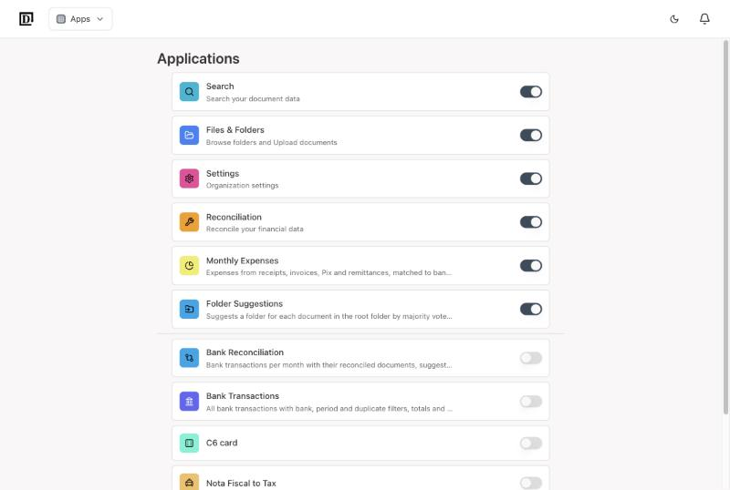

## Monthly Expenses

**What it answers:** where did my money go this month?

It gathers every receipt, invoice, Pix and remittance of the month, groups them by category and checks each one against the bank statement.

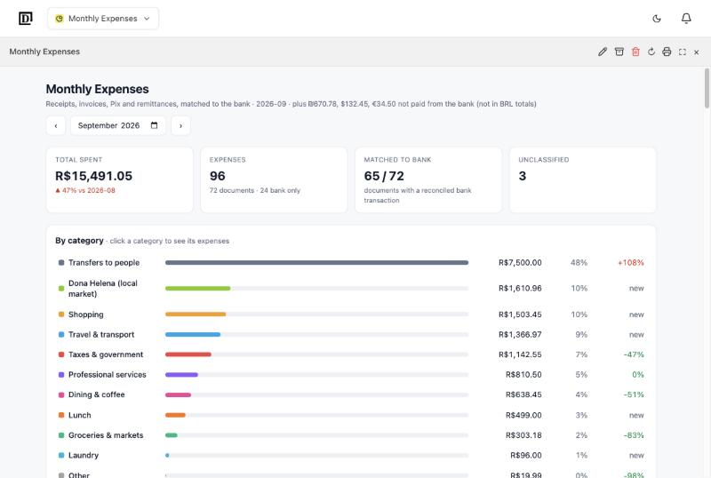

- The four cards at the top show the total spent (and the change from last month), how many expenses there are, how many are matched to a bank transaction, and how many still have no category.
- **By category** shows each category's share of the month and how it changed from the month before.
- Use the arrows next to the month to go back and forward.

Click a category to see its expenses:

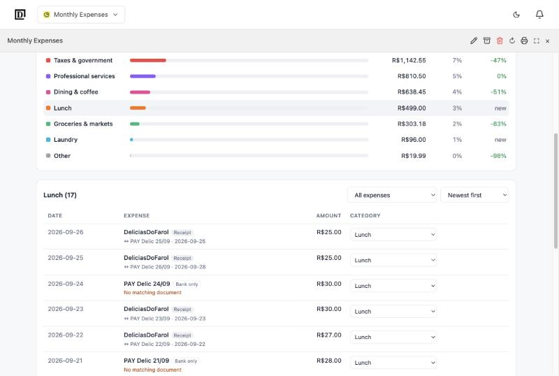

Each line shows the receipt and, under it, the bank transaction it was matched to. A line marked **Bank only** is a payment that appears on the statement but has no receipt yet. To move an expense to another category, pick one from its dropdown.

## Folder Suggestions

**What it answers:** where should these new documents go?

When documents land in the top folder (for example, files you just dropped in), Folder Suggestions looks at the documents you've already filed. If 23 receipts from the same market are all in one folder, the next receipt from that market belongs there too. Each suggestion comes with a confidence level.

Here, five documents are waiting in the top folder: two market receipts, two lunch payments and a laundry payment:

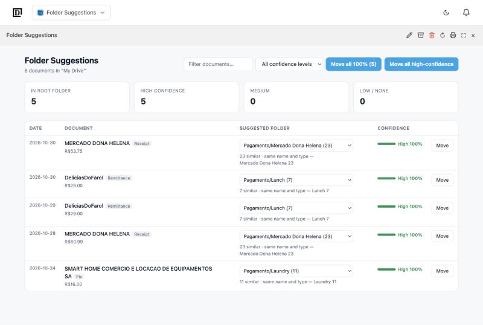

Under each suggestion you can see why it was made, for example "23 similar · same name and type". If you disagree, pick another folder from the dropdown.

Click **Move** to file one document:

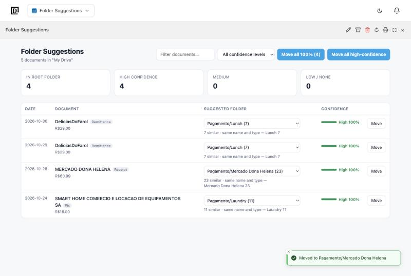

Or click **Move all 100%** (or **Move all high-confidence**) to file everything you're sure about at once:

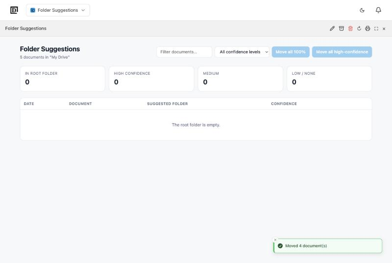

The files move on disk too, so your folder (or Google Drive) stays organized the same way.

## Bank Reconciliation

**What it answers:** which bank transactions are explained by a document, and which aren't?

For each month it lists every bank transaction with the receipt, invoice or remittance that explains it.

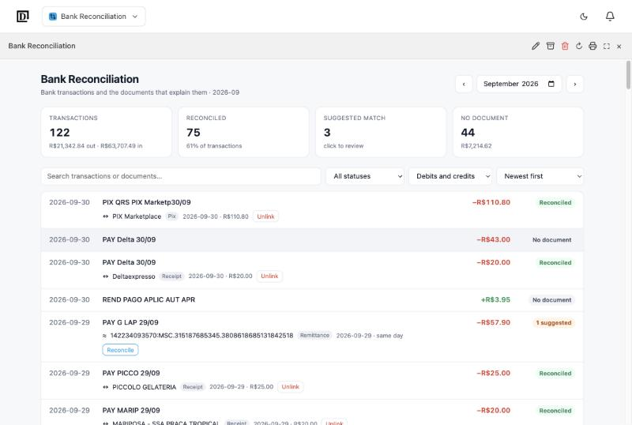

- **Reconciled**: the transaction is linked to its document. **Unlink** undoes the link.
- **Suggested match**: DocAI found a document that fits (same amount, same day) but wants you to confirm it.
- **No document**: nothing explains this transaction yet. These are the ones to chase.

Click the **Suggested match** card to review the suggestions:

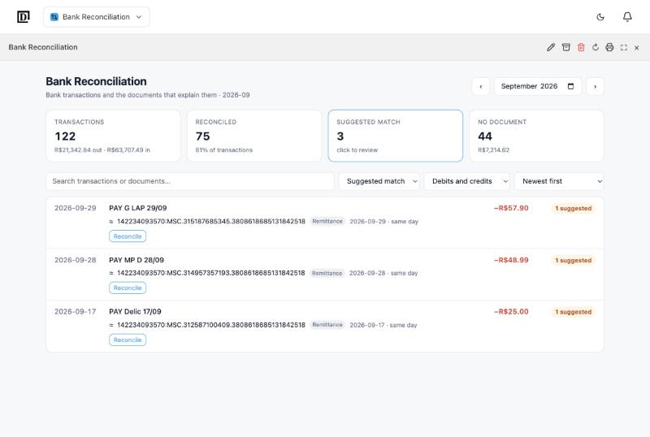

Each suggestion shows the document it found and why ("same day"). If it's right, click **Reconcile**:

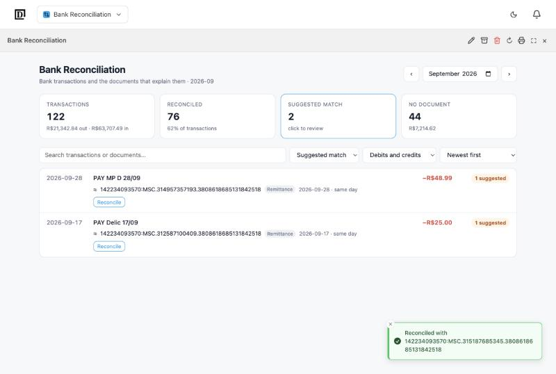

After all three are accepted, nothing is left to review and 78 transactions are reconciled:

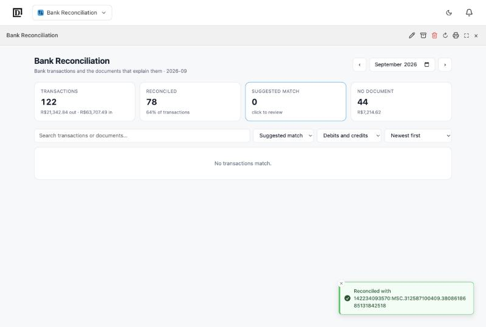

The transaction now shows as reconciled, with the amount of the document it's linked to:

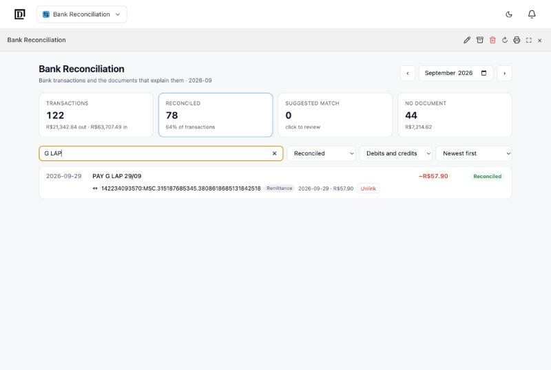

## Build your own

These apps were built by asking Claude, with DocAI connected over MCP (see [Connecting Claude](../README.md#connecting-claude)). Describe the report or workflow you want, for example "a page that shows my VAT for each quarter" or "a list of invoices that are past due". Claude builds the app on your data, and you can ask for changes the same way. The [mini apps reference](mini-apps.md) has the technical details.
