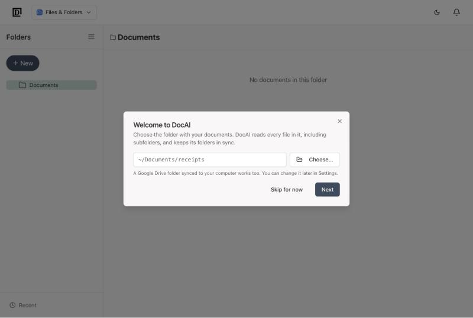
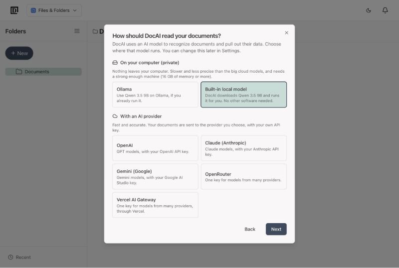
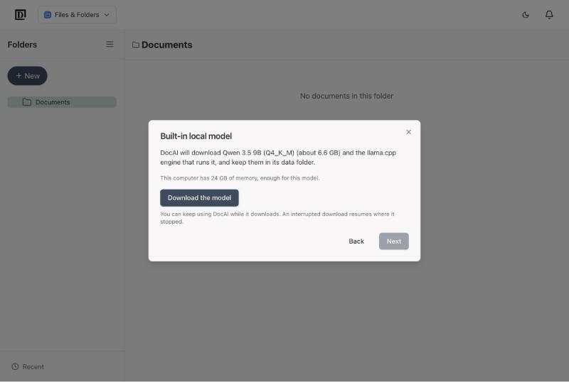
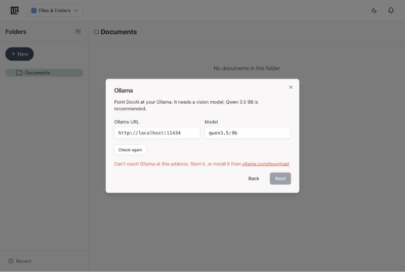
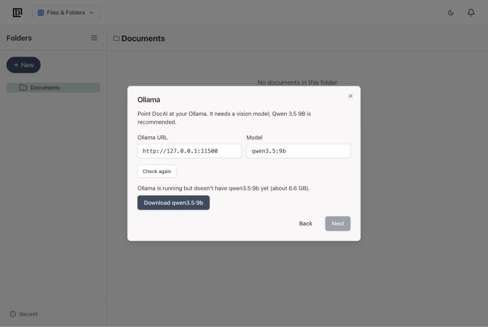
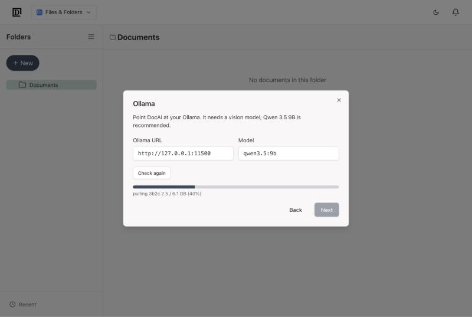
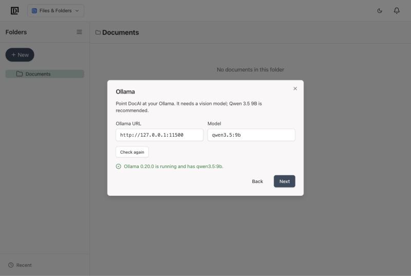
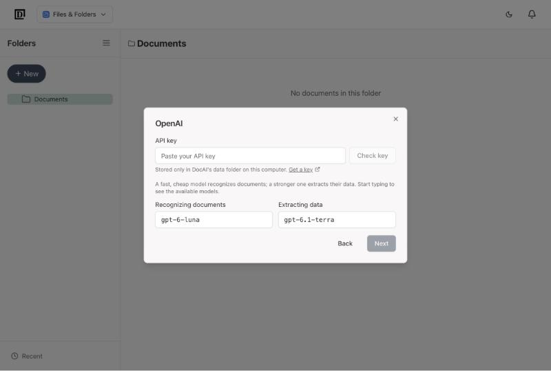
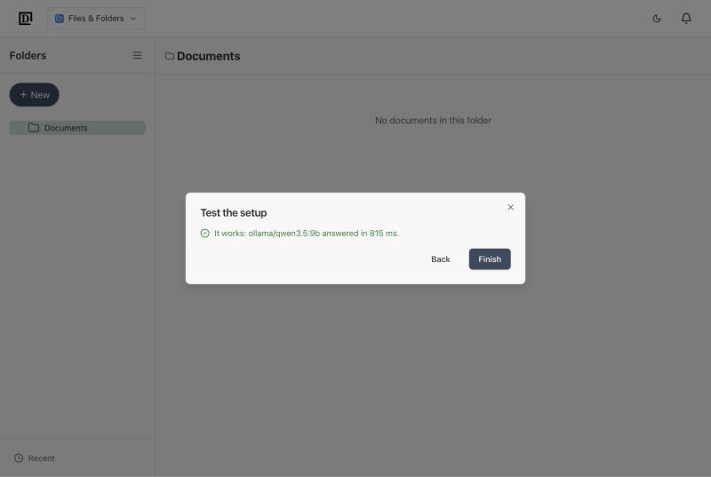
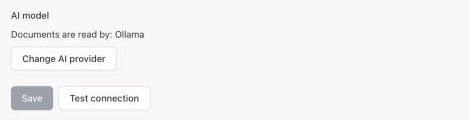

# Setting up DocAI

The first time you open DocAI (http://localhost:4310), a short setup asks two things: where your documents are, and which AI should read them. It takes a minute or two, plus the model download if you choose to run the AI on your own computer.

You can run the AI setup again at any time from **Settings → Processing → Change AI provider**.

## 1. Choose your documents folder

Click **Choose…** and pick the folder that holds your invoices, receipts and bank statements. Subfolders are included. A Google Drive folder synced to your computer works too.

DocAI keeps its folders in sync with this folder. Anything you delete in DocAI goes to a trash folder in DocAI's data folder instead of being deleted for good.

**Skip for now** closes the setup. It comes back the next time you open DocAI.

## 2. Choose where the AI runs

DocAI uses an AI model to recognize each document and pull out its data. You choose where that model runs:

| | On your computer | With an AI provider |
|---|---|---|
| **Privacy** | Your documents never leave your computer | Documents go to the provider you choose |
| **Speed and accuracy** | Slower and less precise | Fast and accurate |
| **What you need** | 16 GB of memory or more | An API key (you pay the provider for what you use) |

Not sure? If you already pay for OpenAI, Claude or Gemini and trust them with your data, pick that provider. If privacy matters most and your computer is recent, try the built-in local model.

## 3a. Built-in local model

DocAI downloads Qwen 3.5 9B (about 6.6 GB) and the engine that runs it, and keeps them in its data folder. No other software is needed. The screen also tells you whether your computer has enough memory.

Click **Download the model**. You can keep using DocAI while it downloads, and an interrupted download picks up where it stopped. When it's done, click **Next**.

## 3b. Ollama

Choose this if you already use [Ollama](https://ollama.com). DocAI checks that Ollama is running:

If it isn't, start Ollama (or install it from ollama.com) and click **Check again**. If Ollama is running but doesn't have the model yet, DocAI offers to download it for you:

When the model is there, you'll see a green check:

## 3c. An AI provider: OpenAI, Claude, Gemini, OpenRouter or Vercel AI Gateway

1. Click **Get a key** to open the provider's key page, create a key and paste it in.
2. Click **Check key**. DocAI confirms the key works and loads the list of models you can use.
3. Keep the suggested models or pick others. DocAI uses two: a fast, cheap one to recognize documents and a stronger one to extract their data. Start typing in a model field to see the options.

Your key is stored only in DocAI's data folder on your computer.

## 4. Test and finish

DocAI sends a small test request to make sure everything works:

Click **Finish**. DocAI starts reading the documents in your folder.

If the test fails, the message says why (a wrong key, Ollama not running, and so on). Go **Back** to fix it, or click **Save anyway** if you want to sort it out later.

## Changing your choice later

Go to **Settings → Processing**. The **AI model** section shows which AI reads your documents. Click **Change AI provider** to run steps 2 to 4 again.

